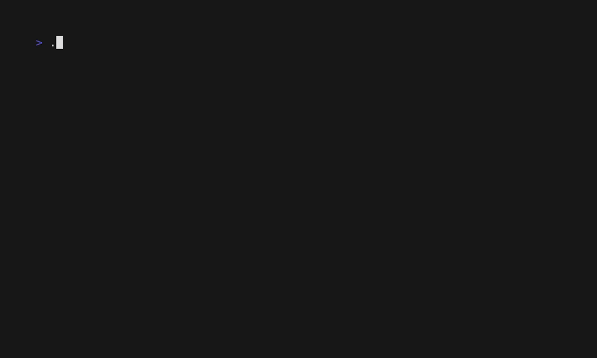

<h1 align="center">RunBeacon</h1>

<p align="center">
  <strong>Fast, searchable troubleshooting runbooks for your terminal.</strong>
</p>

<p align="center">
  <a href="https://github.com/sgrinan/runbeacon/actions/workflows/ci.yml">
    
  </a>
  
  
  
</p>

RunBeacon is a terminal-based troubleshooting tool for quickly finding and reading operational runbooks.

Use the interactive TUI during troubleshooting or the CLI search command from scripts and terminal workflows.

## Demo



## Features

- Interactive TUI with incremental filtering
- Search by runbook ID, title, description, symptoms, and keywords
- Scrollable troubleshooting workflows
- YAML-based runbooks
- Runbook validation on startup
- Non-interactive CLI search

## Installation

Download the latest release for your platform from the [GitHub Releases](https://github.com/sgrinan/runbeacon/releases/latest) page.

| Platform | Archive |
| --- | --- |
| Linux | `runbeacon_<version>_linux_<arch>.tar.gz` |
| macOS | `runbeacon_<version>_darwin_<arch>.tar.gz` |
| Windows | `runbeacon_<version>_windows_<arch>.zip` |

After extracting the archive:

**Linux / macOS**

```bash
./runbeacon
```

**Windows**

```powershell
.\runbeacon.exe
```

Or build RunBeacon from source:

```bash
git clone https://github.com/sgrinan/runbeacon.git
cd runbeacon
go build -o runbeacon ./cmd/runbeacon
./runbeacon
```

## Usage

Launch the interactive TUI:

```bash
./runbeacon
```

Search runbooks directly from the command line:

```bash
./runbeacon search crash
```

Runbooks are loaded from the `runbooks/` directory.

## Runbook format

Runbooks are defined in YAML:

```yaml
id: kubernetes.pod.crashloopbackoff
title: Pod in CrashLoopBackOff
description: Diagnose a pod whose container repeatedly starts and crashes.

symptoms:
  - id: crash-loop
    name: CrashLoopBackOff
    keywords:
      - crash
      - restart
      - backoff

steps:
  - title: Describe pod
    description: Inspect pod events and container state.
    command: kubectl describe pod
```

Each runbook contains searchable symptoms and an ordered troubleshooting workflow.

## Development

Run the validation and test suite:

```bash
gofmt -w .
go vet ./...
go test -race ./...
```

Build the application:

```bash
go build ./cmd/runbeacon
```

The project uses:

- GitHub Actions for automated testing and validation
- Cross-platform CI on Linux, macOS, and Windows
- Dependabot for automated dependency updates
- GoReleaser for automated multi-platform releases

## License

RunBeacon is available under the [MIT License](LICENSE).